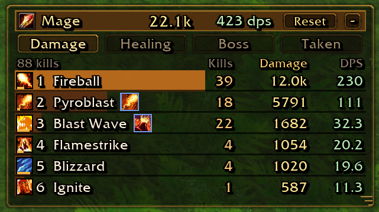

# AZS Spell Meter

Per-spell damage for [Azeroth Survivors](https://wow.aethus.pl/). Damage and each spell's share come from the game's own meter, so they match **Damage Done**. DPS is the last 10 seconds of the run, or another window you set. Kills are counted on top of that, and a proc is shown on the spell it actually casts.

## Why use this instead of Damage Done

- **Several views at once.** Right-click Damage, Healing, Boss, Taken, or Party to open that view in its own window. Spell damage can stay up beside healing, or beside the last boss fight.
- **Kills per spell.** The kill column is how many creatures that spell finished.
- **The spell that was actually cast.** Pyroclasm's explosion is Blast Wave. Damage Done lists Pyroclasm on its own. This meter puts that damage on Blast Wave and leaves a proc button beside it. Upgrading Blast Wave is what upgrades the proc, and the row makes that obvious. Hover the button for the proc's own damage, DPS, and icon.
- **Sortable columns.** Click Kills, Damage, or DPS. Click again to reverse the order.

## Install

1. Download the zip from the [latest release](https://github.com/kex0/AZSSpellMeter/releases/latest). Use the file named `AZSSpellMeter`, not the Source code links. Those unpack as `AZSSpellMeter-main`, and the game will not list that folder.
2. In game, open **Options → AddOns → Open AddOns Folder**.
3. Unzip there, so the path ends in `AddOns/AZSSpellMeter/AZSSpellMeter.toc`. A folder named `AZSSpellMeter-main` or `AZSSpellMeter-1.32` will not load. Rename it to `AZSSpellMeter`, or if that folder is inside it, move that one up into AddOns.
4. Relog. Addons only load at login.

Requires Azeroth Survivors 0.87 or newer, for `AZS_GetMeter`. Healing, Boss, and Taken need a current game build.

## Use

Drag the title bar, or the damage and DPS numbers, to move the window. Drag the corner to resize it. If the list is longer than the window, the last spell sits partly in view. Scroll with the mouse wheel.

Damage, Healing, Boss, Taken, and Party are the buttons under the title. Damage includes kills per spell. Healing is health actually restored. Boss is the last boss fight, and it stays up until the next boss. Taken is the damage you took, split by what hit you. Party shows each hero's damage, and only while you are in co-op. Hover a hero's strongest spell to see what it does. The name is in your language. Spell icons and grouped talents still work when a partner plays in another language. DPS looks back 10 seconds unless you change that in settings. A thin bar under a spell icon is its cooldown. Hover a spell for its hits and crits. Hover the total for your build stats.

The gear on the title bar opens settings: scale, opacity, background, the DPS window, columns, colors, cooldown bars, and lock. Share is that spell's part of the total. Each spell alone lists every spell, talent, and item on its own row, as Damage Done does. A proc is the spell it casts, so that row has no kill count. Under the spell adds an arrow that lists the talents grouped into a spell. Wrap names splits a long name onto a second line, and it is off until you turn it on. Since the start there uses the average for the whole run, or the whole boss fight. Right-click the bubble for the same window. Reset settings there puts those back. Your numbers and window positions stay.

Right-click a button to open that view in its own window. The button stays, dimmed. Click it, or the x on the extra window, to bring the view back. Each view is only in one place. The extra window has its own size, position, and Reset.

| Command | |
|---|---|
| `/azsm` | Show or hide. If the window is off screen, this brings it back |
| `/azsm reset` | Start this window over |
| `/azsm resetpos` | Put the window back on screen |
| `/azsm lock` | Lock or unlock dragging |
| `/spellmeter` | Same as `/azsm` |

While the main window, its bubble, or an extra window is open, the built-in Damage Done meter is hidden. It comes back when all of them are closed, if it was on before.

The window position is remembered across updates. Deleting the addon folder does not clear it. If the window is missing, type `/azsm resetpos`.

## Changelog

### 1.33

Tested with game 0.127.0.

- The meter, its extra windows, the bubble, graphs, and settings sit above level-up and item cards when the game provides AZS_SetOnTopOfScreens.
- Choker of the Fire Lord groups onto Blast Wave, Eye of Hakkar onto Ignite, and Corpse Explosion onto Seed of Corruption.
- Two or more minions fold into one Pets row you can open. One minion keeps its own name. An imp's hits and kills stay on Imp.
- Death Coil and Hellfire are not folded onto a summon.
- Opening a grouped spell shows that spell's own damage first, then the talent or item.
- The amount column can be hidden on Healing and Taken too.
- The biggest crit shows on the spell and on the total.
- Each view can open its own graph from the chart button on the title bar. Several graphs can stay open at once.
- The graph plots amount or DPS over the run. Scroll to zoom, drag to pan, and hover for a value at that time.
- Follow keeps the live end in view. Full keeps the whole run in view. Compact hides the timeline and axis labels so the header sits flush on the plot.
- Amount and DPS (or Healing and HPS) switch on the graph itself. The live number on the graph is for that graph's view.
- UI tweaks and fixes.

### 1.32

Tested with game 0.123.0.

- Each spell alone lists every spell, talent, and item on its own row, as Damage Done does.
- A proc in that list has no kill count, because a proc is the spell it casts.
- Settings are split into Window, DPS, Rows, Columns, and Colors.

### 1.31

Tested with game 0.113.3.

- An icon after a spell name no longer covers that spell's kill count.
- Damage from your only summon, such as a Water Elemental, uses that summon's name and icon.
- Wolf, Raptor, Treant, and Spirit Wolf have icons.

### 1.30

Tested with game 0.113.3.

- Another hero's strongest spell is named in your language.
- A spell keeps its icon when a co-op partner's game is in another language.
- A talent groups under the spell it casts even when a partner's spell names are not in English.
- The same talent no longer shows twice under one spell when a partner's game is in another language.
- Hovering another hero's strongest spell shows what that spell does.
- The tip for another hero's strongest spell does not include your own damage bonuses.
- The tip for another hero's strongest spell does not say you have not learned that spell.
- Divine Storm has an icon beside a hero's name.
- Imp, Felhunter, Succubus, and Pit Lord have icons beside a hero's name.
- Choker of the Fire Lord has an icon beside a hero's name.
- Pendant of the Plague: Moonfire shows Moonfire's icon.
- A spell or item that was missing its picture now has one.

### 1.27

Tested with game 0.113.1.

- Share shows each spell's part of the total.
- Kills, Damage, Share, and DPS can each be hidden.
- Under the spell adds an arrow that opens the talents grouped into a spell.
- Sweeping Strikes shows on Cleave, Mortal Strike, and Execute.
- An item that adds to a spell is grouped into that spell.
- A pet's attacks use the pet's name.
- Infernal, Doomguard, and Felguard have icons.
- Hover a spell to see its hits, crits, and crit chance.
- Columns widen just enough for a long number, and they stop shifting as DPS changes.
- Wrap names splits a long name onto a second line. It is off until you turn it on.
- An item's icon stays after a reload, once the meter has seen it.
- Party shows each hero's damage while you are in co-op.
- The Party tab is hidden when you play alone.
- Each hero's strongest spell sits beside their name.

### 1.26

Tested with game 0.107.0.

- You can choose how far back DPS looks. It still starts at 10 seconds, from 5 seconds up to 2 minutes.
- Since the start shows the average for the whole run.

### 1.25

Tested with game 0.107.0.

- Talents that trigger a spell, such as Flurry and Rampage, now show on that spell instead of as their own row.
- Hovering one of those talents no longer lists kills.

### 1.24

Tested with game 0.105.0.

- DPS is the last 10 seconds of the run. Kills from the English combat log stay on the translated spell row.

### 1.23

Tested with game 0.104.0.

- A gear on the title bar opens settings for scale, opacity, background, colors, cooldown bars, and lock.
- Scale grows from the top-left of each open window. Windows and tooltips stay on the screen.
- Reset settings puts those back. Numbers and window positions stay.

### 1.22

Tested with game 0.102.2.

- Fixed the load error after the latest game update: `too many upvalues (limit=32)`. Relog to load it.
- Tooltips show again on hover. The anchor name had been rewritten into something the game rejects.
- The close and minimize marks sit in the middle of their buttons. Text uses a centered outline instead of a drop shadow.
- Windows can sit against the right edge of the screen. Tooltips follow the cursor there too.
- Resizing an extra window lets go when the mouse button does.
- The title bar takes the color of the view it is showing.
- Damage, Healing, Boss, and Taken stretch across the full width of the window.

### 1.21

- Right-click Damage, Healing, Boss, or Taken to open that view in its own window. The button stays, dimmed.
- Click the dimmed button, or the x on the extra window, to bring the view back.
- Each view is only shown in one place. An extra window has its own size, position, and Reset.
- The built-in meter stays hidden while any of these windows is open.

### 1.20

- Damage, Healing, Boss, and Taken are the buttons under the title. Damage stays selected until you pick another.
- Healing matches Healing Done. Kills keep counting, and they are not listed on that view.
- Boss matches the last boss fight. The kills column is hidden there too.
- Taken splits damage you took by source. On death, one chat line names the biggest source.
- Reset clears only the view you are looking at.
- The title shows your class. Spell cooldowns sit under the icon, and the total's tooltip lists your build.
- Leech, items, and the Taken rows have their own icons.

### 1.19

- The window stays on screen. A position saved off screen is moved back on login.
- `/azsm resetpos` puts the window back in the top-left without wiping the meter.

### 1.18

- Fixed the chat error that appeared while the meter looked up spell icons.

### 1.17

- Damage, DPS, and share are read from the game's meter. They match Damage Done.
- Kills per spell. A proc's kills stay with the spell it casts.
- Procs are grouped under that spell, with a button for the proc's own numbers and icon.
- Reset clears this window only. The built-in meter is unchanged.
- The list clips to the window, so resizing can leave a spell half visible.
- Tooltips sit above the cursor, follow it, and update while you hover. Share is shown there.
- Compact title bar. Minimize collapses the window to a bubble on that button.
