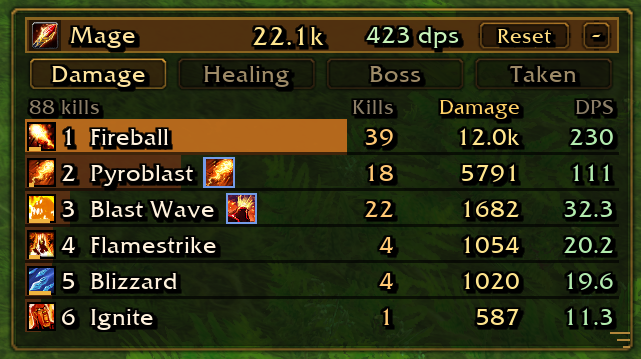

# AZS Spell Meter

Per-spell damage for [Azeroth Survivors](https://wow.aethus.pl/). Damage and each spell's share come from the game's own meter, so they match **Damage Done**. DPS is the last 10 seconds of the run, or another window you set. Kills are counted on top of that, and a proc is shown on the spell it actually casts.



## Why use this instead of Damage Done

- **Several views at once.** Right-click Damage, Healing, Boss, Taken, or Party to open that view in its own window. Spell damage can stay up beside healing, or beside the last boss fight.
- **Kills per spell.** The kill column is how many creatures that spell finished.
- **The spell that was actually cast.** Pyroclasm's explosion is Blast Wave. Damage Done lists Pyroclasm on its own. This meter puts that damage on Blast Wave and leaves a proc button beside it. Upgrading Blast Wave is what upgrades the proc, and the row makes that obvious. Hover the button for the proc's own damage, DPS, and icon.
- **Sortable columns.** Click Kills, Damage, or DPS. Click again to reverse the order.

## Install

1. Download the zip from the [latest release](https://github.com/kex0/AZSSpellMeter/releases/latest). Use the file named `AZSSpellMeter`, not the Source code links. Those unpack as `AZSSpellMeter-main`, and the game will not list that folder.
2. In game, open **Options → AddOns → Open AddOns Folder**.
3. Unzip there, so the path ends in `AddOns/AZSSpellMeter/AZSSpellMeter.toc`. A folder named `AZSSpellMeter-main` or `AZSSpellMeter-1.32` will not load. Rename it to `AZSSpellMeter`, or if that folder is inside it, move that one up into AddOns.
4. Relog. Addons only load at login.

Requires Azeroth Survivors 0.87 or newer, for `AZS_GetMeter`. Healing, Boss, and Taken need a current game build.

## Use

Drag the title bar, or the damage and DPS numbers, to move the window. Drag the corner to resize it. If the list is longer than the window, the last spell sits partly in view. Scroll with the mouse wheel.

Damage, Healing, Boss, Taken, and Party are the buttons under the title. Damage includes kills per spell. Healing is health actually restored. Boss is the last boss fight, and it stays up until the next boss. Taken is the damage you took, split by what hit you. Party shows each hero's damage, and only while you are in co-op. Hover a hero's strongest spell to see what it does. The name is in your language. Spell icons and grouped talents still work when a partner plays in another language. DPS looks back 10 seconds unless you change that in settings. A thin bar under a spell icon is its cooldown. Hover a spell for its hits and crits. Hover the total for your build stats.

The gear on the title bar opens settings: scale, opacity, background, the refresh rate, the DPS window, columns, colors, cooldown bars, and lock. Share is that spell's part of the total. Each spell alone lists every spell, talent, and item on its own row, as Damage Done does, and that row keeps its kills. Under the spell adds an arrow that lists the talents grouped into a spell. Wrap names splits a long name onto a second line, and it is off until you turn it on. Since the start there uses the average for the whole run, or the whole boss fight. Right-click the bubble for the same window. Reset settings there puts those back. Your numbers and window positions stay.

Right-click a button to open that view in its own window. The button stays, dimmed. Click it, or the x on the extra window, to bring the view back. Each view is only in one place. The extra window has its own size, position, and Reset.

| Command | |
|---|---|
| `/azsm` | Show or hide. If the window is off screen, this brings it back |
| `/azsm reset` | Start this window over |
| `/azsm resetpos` | Put the window back on screen |
| `/azsm lock` | Lock or unlock dragging |
| `/spellmeter` | Same as `/azsm` |

While the main window, its bubble, or an extra window is open, the built-in Damage Done meter is hidden. It comes back when all of them are closed, if it was on before.

The window position is remembered across updates. Deleting the addon folder does not clear it. If the window is missing, type `/azsm resetpos`.

## Tests

The tests in `tests/` load the addon outside the game with a small stand-in for the 1.12 client. They need Lua 5.0 (or 5.1). From the repository folder:

```
lua50 tests/run.lua
```

They sit outside the `AZSSpellMeter` folder, so the release zip and the game never see them.

## Changelog

### 1.39.4

- Settings has a Refresh rate under Window, from 0.25 to 2 seconds in 0.25 s steps. It sets how often the meter windows redraw and starts at 1 second. The DPS graph keeps sampling at its own pace, so its line stays as fine. Clicks, tab changes, and settings still redraw at once.
- A kill no longer redraws the whole meter. It shows on the next redraw, so a big pull with many deaths costs far less.
- Combat text is read 20 times a second instead of every frame. A death reads it first, so the kill still goes to the spell that landed the last hit.
- Hits, the boss fight check, window placement, and open tips do less work per frame. Long runs no longer keep every hit's id.

### 1.39.3

- Totems each stay on their own row. They are no longer grouped together as pets.
- Searing Totem shows the kills from its shots. Magma Totem's kills stay on one number.
- The row numbers stay visible beside the spell name.

### 1.39.2

- Lightning Overload's kills are shared by Lightning Bolt and Chain Lightning, the same way its damage is.
- Righteous Hammer is grouped under Hammer of Wrath.
- Hover a spell to see its biggest crit, including a talent opened under that spell.
- Opening a spell's talents keeps those rows and leaves their layout in place, so the list does less work on each refresh.
- The columns sit closer together. The Damage column is labeled Dmg.

### 1.39.1

- A grouped spell shows its kills on the main skill, and each of a minion's attacks keeps the kills from that attack. Felseeker keeps the kills the log records as Searing Pain. Shadow Bolt on a Doomguard stays separate from yours.
- A minion's spell keeps a DPS number from its damage, instead of sitting at 0. Each spell alone lists a proc, such as Arcane Concentration, on its own row with its kills.
- Kills stay for the run. A clock dip or leaving the death screen no longer clears them while damage is still on the meter. Reloading keeps the kills from this run.

### 1.39

For game 0.139.0. Older builds keep the combat log.

- Hits, crits, and biggest hits follow the meter line the game puts on each combat-text number. A pet or summon hit stays on that pet. A strike that floats as another spell, such as Shadow Weaving on Shadow Word: Pain, stays on the spell the meter names.
- A kill still comes from the death message. It is credited to the last meter line that hit that enemy.
- Boss hits, crits, and kills stay limited to the current boss fight.
- A minion's spells keep a steady hit, crit, and kill count while the minion is expanded.
- Damage, percent, and kills widen with their numbers, and each shrinks only after the number has stayed narrower for 10 seconds.

### 1.38.1

Tested with game 0.135.1.

- The loadout lookup uses a name addon scanners no longer treat as loading code.

### 1.38

Tested with game 0.135.1.

- The minimized meter stays where you left it. A new run no longer sends it back to the center of the screen. Opening it puts the window on the bubble.
- Right-click the minimized meter to switch it between total damage, DPS, and kills. The tip names the one it is showing.

### 1.37

Tested with game 0.135.1.

- A party member opens into that hero's spells, healing, and boss damage. Back returns to the party list.
- A pet's spell stays on the pet, and each minion keeps its own icon. Two or more demons still share the Minions row, and other pets share Pets.
- A proc stays on the spell that cast it, as an icon beside that spell.
- When the combat log names a minion, those hits, crits, and kills stay on that minion. Your own casts of the same spell stay on your spell.
- Healing can show what you cast as well as what you received. The switch sits under the title and is remembered.
- Spell icons, ranks, and which spell a proc belongs to come from the game.
- Right-click a row to hide it. The total and DPS still include it. The row comes back when you change tabs, switch Received and Done, close and reopen an extra window, or the run resets.
- Death Coil stays on the Succubus unless you have that skill selected.
- A minion row is labeled x2, x3, and so on when more than one of that minion is out, including when it is opened under Minions. The same count is in its tip. One of that minion has no number, and the Minions row stays Minions.
- Each spell alone lists a proc on its own row. A minion's attacks stay on that minion, and Under the spell can still open them. A spell is not also shown as an icon of itself.
- A party member's spells follow Each spell alone. Received and Done stay inside the party window.
- The party list no longer rebuilds every hero's spell history several times a second.
- One window stays as light as the old meter. The bars read the totals the game already stored, instead of building a full breakdown report every tick.
- The party list includes the other heroes again. Their totals are requested instead of reading only your own.
- The party list switches between damage and healing from the icon on the column row. A sword is damage. The heal icon is healing each hero has done. The party graph follows that icon, and the icon stays visible on the level-up screen. Party damage and party healing both keep their graph line while the other one is showing.
- A few seconds of lag no longer clears the graphs. The line stays and follows the run clock.
- Extra views take turns. The window in front stays live, and opening more views does not rebuild all of them on the same frame. A graph redraws only when its line has new data.
- A spell still gets its hits, crits, kills, and rank when the meter spells its name differently from the combat log or the spell book. Soul Fire and Soulfire count as the same spell, and the rank is the one on the spell you have selected.
- Boss hits, crits, and kills are for the current boss fight.
- A proc the game marks sits on the spell it came from, as an icon. That includes Splitting Ice on Frostbolt. Flurry, Shockwave, Mutilate, Blade Flurry, Conflagrate, and Sweeping Strikes do the same when the game calls them procs.
- Presence of Mind stays on Arcane Missiles, Seal of Command on Judgement, and Divine Storm on Exorcism.
- Righteous Hammer has an icon. Which spell it belongs to is still unknown, so it keeps its own row.

### 1.36

Tested with game 0.131.0.

- Armor set bonuses that hit with a spell are counted on that spell. The set shows as an icon beside it, and the kills stay there. Judgement's bonus is already Judgement.
- Spell names keep their full text when there is room before the numbers.
- Each damage bar has a light top edge, a dark foot, and a gap under it. Each spell down the list is clearly darker than the one above it.
- Settings can keep every bar the same brightness.
- Hovering a spell raises that bar to the same brightness as the top spell.
- A spell, item, or proc that can be upgraded shows its rank under the name, beside the icon.
- When the window is too narrow for the class name, the total and DPS sit where that name was.
- The graph opened from the main window follows the selected tab. A graph opened from a separate view stays on that view.
- A sharp jump on the graph is a solid line.
- Minions stay off a view when they added nothing to it. Healing, Boss, and Taken no longer keep a Minions row at zero.

### 1.35

Tested with game 0.130.1.

- UI scale in settings makes the meter, its extra windows, graphs, and tips smaller or bigger, from 50% to 200%. Settings itself uses the new size the next time you open it.
- A graph can be dragged from the number on its title bar.
- Numbers turn into 1.1k once they pass 999.
- Sweeping Strikes, Flurry, Mutilate, Conflagrate, Shockwave, and Splitting Ice keep their own rows instead of vanishing into other spells.
- Bars fill against the top spell by default. Settings can switch them back to the run total.
- Hovering a spell row highlights the whole row.
- Boss tips and hit stats are for that boss fight, not the whole run.
- Settings can show or hide the Damage, Healing, Boss, and Taken buttons.
- Settings no longer has a DPS graph checkbox. Open a graph from the chart button on a meter.
- A compact graph shows the zoom in the top-left corner. The small R beside it returns to the DPS window from settings and follows the live end. Hovering R explains that, instead of the value at that time.
- Warlock demons group under Minions. Inferno, Dread Lord, and Doomguard join that group. Dread Lord and Doomguard use their talent icons.
- The Minions row shows up to six icons, in a fixed order, immediately after the name. When the row is too narrow, extras stack with a faint +N, and the tip shows each one in full. The kills column keeps a fixed width so those icons do not jump.
- The Minions or Pets tip names who landed the biggest crit, and each pet tip shows its own.
- Imp, Voidwalker, Succubus, and Infernal show hits, crits, and biggest crit. Imp Fireball and Infernal Hellfire are counted on the minion.
- Hovering Dread Lord or Doomguard says their hits, crits, and kills are counted on Searing Pain or Shadow Bolt when you are also casting that spell. If that spell has no damage of yours, those stats are counted on the minion instead.

### 1.34

Tested with game 0.127.0.

- Graphs hitch less during big AoE while they stay open. The line still updates live.

### 1.33

Tested with game 0.127.0.

- The meter, its extra windows, the bubble, graphs, and settings sit above level-up and item cards when the game provides AZS_SetOnTopOfScreens.
- Choker of the Fire Lord groups onto Blast Wave, Eye of Hakkar onto Ignite, and Corpse Explosion onto Seed of Corruption.
- Two or more minions fold into one Pets row you can open. One minion keeps its own name. An imp's hits and kills stay on Imp.
- Death Coil and Hellfire are not folded onto a summon.
- Opening a grouped spell shows that spell's own damage first, then the talent or item.
- The amount column can be hidden on Healing and Taken too.
- The biggest crit shows on the spell and on the total.
- Each view can open its own graph from the chart button on the title bar. Several graphs can stay open at once.
- The graph plots amount or DPS over the run. Scroll to zoom, drag to pan, and hover for a value at that time.
- Follow keeps the live end in view. Full keeps the whole run in view. Compact hides the timeline and axis labels so the header sits flush on the plot.
- Amount and DPS (or Healing and HPS) switch on the graph itself. The live number on the graph is for that graph's view.
- UI tweaks and fixes.

### 1.32

Tested with game 0.123.0.

- Each spell alone lists every spell, talent, and item on its own row, as Damage Done does.
- A proc in that list has no kill count, because a proc is the spell it casts.
- Settings are split into Window, DPS, Rows, Columns, and Colors.

### 1.31

Tested with game 0.113.3.

- An icon after a spell name no longer covers that spell's kill count.
- Damage from your only summon, such as a Water Elemental, uses that summon's name and icon.
- Wolf, Raptor, Treant, and Spirit Wolf have icons.

### 1.30

Tested with game 0.113.3.

- Another hero's strongest spell is named in your language.
- A spell keeps its icon when a co-op partner's game is in another language.
- A talent groups under the spell it casts even when a partner's spell names are not in English.
- The same talent no longer shows twice under one spell when a partner's game is in another language.
- Hovering another hero's strongest spell shows what that spell does.
- The tip for another hero's strongest spell does not include your own damage bonuses.
- The tip for another hero's strongest spell does not say you have not learned that spell.
- Divine Storm has an icon beside a hero's name.
- Imp, Felhunter, Succubus, and Pit Lord have icons beside a hero's name.
- Choker of the Fire Lord has an icon beside a hero's name.
- Pendant of the Plague: Moonfire shows Moonfire's icon.
- A spell or item that was missing its picture now has one.

### 1.27

Tested with game 0.113.1.

- Share shows each spell's part of the total.
- Kills, Damage, Share, and DPS can each be hidden.
- Under the spell adds an arrow that opens the talents grouped into a spell.
- Sweeping Strikes shows on Cleave, Mortal Strike, and Execute.
- An item that adds to a spell is grouped into that spell.
- A pet's attacks use the pet's name.
- Infernal, Doomguard, and Felguard have icons.
- Hover a spell to see its hits, crits, and crit chance.
- Columns widen just enough for a long number, and they stop shifting as DPS changes.
- Wrap names splits a long name onto a second line. It is off until you turn it on.
- An item's icon stays after a reload, once the meter has seen it.
- Party shows each hero's damage while you are in co-op.
- The Party tab is hidden when you play alone.
- Each hero's strongest spell sits beside their name.

### 1.26

Tested with game 0.107.0.

- You can choose how far back DPS looks. It still starts at 10 seconds, from 5 seconds up to 2 minutes.
- Since the start shows the average for the whole run.

### 1.25

Tested with game 0.107.0.

- Talents that trigger a spell, such as Flurry and Rampage, now show on that spell instead of as their own row.
- Hovering one of those talents no longer lists kills.

### 1.24

Tested with game 0.105.0.

- DPS is the last 10 seconds of the run. Kills from the English combat log stay on the translated spell row.

### 1.23

Tested with game 0.104.0.

- A gear on the title bar opens settings for scale, opacity, background, colors, cooldown bars, and lock.
- Scale grows from the top-left of each open window. Windows and tooltips stay on the screen.
- Reset settings puts those back. Numbers and window positions stay.

### 1.22

Tested with game 0.102.2.

- Fixed the load error after the latest game update: `too many upvalues (limit=32)`. Relog to load it.
- Tooltips show again on hover. The anchor name had been rewritten into something the game rejects.
- The close and minimize marks sit in the middle of their buttons. Text uses a centered outline instead of a drop shadow.
- Windows can sit against the right edge of the screen. Tooltips follow the cursor there too.
- Resizing an extra window lets go when the mouse button does.
- The title bar takes the color of the view it is showing.
- Damage, Healing, Boss, and Taken stretch across the full width of the window.

### 1.21

- Right-click Damage, Healing, Boss, or Taken to open that view in its own window. The button stays, dimmed.
- Click the dimmed button, or the x on the extra window, to bring the view back.
- Each view is only shown in one place. An extra window has its own size, position, and Reset.
- The built-in meter stays hidden while any of these windows is open.

### 1.20

- Damage, Healing, Boss, and Taken are the buttons under the title. Damage stays selected until you pick another.
- Healing matches Healing Done. Kills keep counting, and they are not listed on that view.
- Boss matches the last boss fight. The kills column is hidden there too.
- Taken splits damage you took by source. On death, one chat line names the biggest source.
- Reset clears only the view you are looking at.
- The title shows your class. Spell cooldowns sit under the icon, and the total's tooltip lists your build.
- Leech, items, and the Taken rows have their own icons.

### 1.19

- The window stays on screen. A position saved off screen is moved back on login.
- `/azsm resetpos` puts the window back in the top-left without wiping the meter.

### 1.18

- Fixed the chat error that appeared while the meter looked up spell icons.

### 1.17

- Damage, DPS, and share are read from the game's meter. They match Damage Done.
- Kills per spell. A proc's kills stay with the spell it casts.
- Procs are grouped under that spell, with a button for the proc's own numbers and icon.
- Reset clears this window only. The built-in meter is unchanged.
- The list clips to the window, so resizing can leave a spell half visible.
- Tooltips sit above the cursor, follow it, and update while you hover. Share is shown there.
- Compact title bar. Minimize collapses the window to a bubble on that button.
